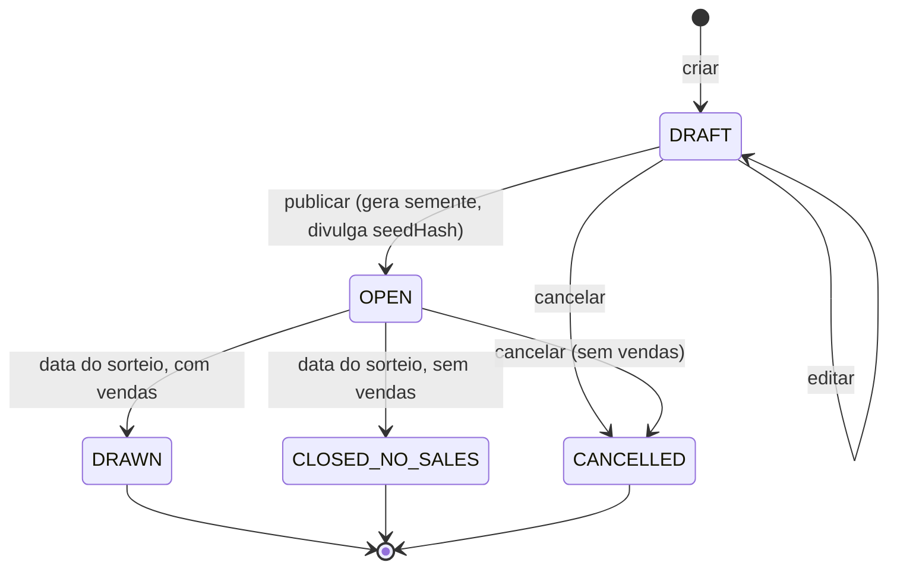

# 🎟️ Sorteios API

API REST de rifas online com **sorteio auditável**: qualquer pessoa pode recalcular o vencedor e provar que o resultado não foi manipulado depois das vendas.

[](https://github.com/lucasaccioly/sorteios-api/actions/workflows/ci.yml)


## 🚀 Demo

**Swagger:** https://sorteios-api.onrender.com

| Conta | E-mail | Senha |
|---|---|---|
| Participante | `participante@demo.dev` | `demo12345` |
| Organizadora | `organizador@demo.dev` | `demo12345` |

> ⏳ A demo roda no plano gratuito do Render, que hiberna sem uso: o **primeiro acesso pode levar ~1 min**.

**Teste em 1 minuto:**

1. `POST /api/auth/login` com uma das contas acima. Você também pode criar a sua em `/api/auth/register`.
2. Copie o `token`, clique em **Authorize** e cole.
3. `GET /api/raffles?status=OPEN`, escolha uma rifa e faça `POST /api/raffles/{id}/tickets` com `{"quantity": 2}`.
4. Abra uma rifa já sorteada (`status=DRAWN`) e confira a prova em `GET /api/raffles/{id}/proof`.

A demo se mantém sozinha. Ao subir, ela cria uma rifa em cada estado e, a cada 10 min, garante que existe uma rifa aberta com números livres.

## O que a API faz

- **Organizadores** criam rifas: prêmio, preço, quantidade de números (10 a 10.000), limite por pessoa e data do sorteio.
- **Participantes** compram números escolhidos (`{"numbers": [7, 13]}`) ou aleatórios (`{"quantity": 3}`).
- Na data marcada, o **sorteio acontece automaticamente**: um job roda a cada minuto e abrir os detalhes da rifa (`GET /api/raffles/{id}`) também dispara o sorteio.
- Depois do sorteio, a **prova** fica pública e pode ser verificada por qualquer um.



## 🔐 Como funciona o sorteio auditável

O sorteio usa **commit-reveal**:

1. **Commit.** Ao publicar a rifa, o servidor gera uma semente aleatória de 32 bytes e divulga só o hash dela, `seedHash = SHA-256(seed)`. A semente fica secreta.
2. **Vendas.** As vendas acontecem normalmente.
3. **Reveal.** Na data do sorteio, o vencedor é calculado a partir da semente e de **todos** os bilhetes vendidos. A semente passa a ser pública.

```text
ticketsLine   = "numero:userId" de cada bilhete, em ordem crescente de número, separados por ","
ticketsDigest = hex(SHA-256(utf8(ticketsLine)))
h             = SHA-256(seed || utf8(ticketsDigest))
winnerIndex   = (primeiros 8 bytes de h, big-endian, sem sinal) mod quantidade_de_bilhetes
```

**O que isso garante:**

- O `seedHash` foi publicado antes das vendas, então a semente não pode ter sido trocada depois.
- Qualquer alteração nos bilhetes muda o `ticketsDigest` e, portanto, o vencedor.

**Verifique você mesmo** com o script em Python, que usa só a biblioteca padrão:

```bash
python scripts/verify_draw.py https://sorteios-api.onrender.com/api/raffles/<id>/proof
```

Ele imprime `OK` e sai com código 0 quando o vencedor confere. Com uma prova adulterada, imprime `FALHOU` e sai com código 1.

O script confere a prova contra ela mesma. Para a garantia completa, anote o `seedHash` da rifa **antes de comprar** e confira se é o mesmo que aparece na prova.

> **Limitação assumida:** quem opera o servidor conhece a semente antes do sorteio. Eliminar isso exigiria uma fonte externa de entropia, como um beacon público ou o hash de um bloco futuro, o que está fora do escopo deste projeto.

## 🧠 Decisões técnicas

| Tema | Decisão |
|---|---|
| **Concorrência na compra** | `SELECT ... FOR UPDATE` na rifa serializa compras e sorteio. A constraint `UNIQUE(raffle_id, number)` é a última linha de defesa. Um teste dispara compras simultâneas e prova que nenhum número é vendido duas vezes. |
| **Sorteio exatamente uma vez** | O job e a leitura sob demanda usam a mesma transação com lock (`REQUIRES_NEW`). Se dois chegarem juntos, o segundo encontra a rifa já sorteada. |
| **Erros** | [RFC 9457 Problem Details](https://www.rfc-editor.org/rfc/rfc9457) com mensagens em pt-BR. Validação gera 400, regra de negócio gera 409 e falta de autenticação gera 401. |
| **404 em vez de 403** | Uma rifa em rascunho de outra pessoa responde 404. Assim a API não confirma que o recurso existe. |
| **Autenticação** | JWT HS256 com o resource server do Spring Security, senha com BCrypt e papéis `USER` e `ADMIN`. O primeiro admin vem de variáveis de ambiente. |
| **Tempo testável** | Um `Clock` é injetado em todo o código. Os testes avançam o relógio para simular a data do sorteio e a expiração do token. |
| **Testes com Postgres real** | Usa [embedded-postgres](https://github.com/zonkyio/embedded-postgres): os testes rodam no Postgres de verdade, sem Docker e sem H2. |
| **Schema** | As migrations ficam no Flyway e o Hibernate roda só com `ddl-auto: validate`. |
| **Ordenação segura** | O parâmetro `sort` só aceita campos de uma lista permitida. Sem isso, ordenar por um campo aninhado, como `organizer.email`, vazaria dados pela ordem dos resultados. |

**Próximos passos:** limite de requisições (rate limiting) no login e no cadastro, e uma fonte externa de entropia para o sorteio.

## 📚 Endpoints

| Método | Rota | Auth | Descrição |
|---|---|---|---|
| POST | `/api/auth/register` | — | Cria conta e devolve token |
| POST | `/api/auth/login` | — | Login, devolve token (24h) |
| GET | `/api/me` | ✔ | Usuário atual |
| POST | `/api/raffles` | ✔ | Cria rifa (rascunho) |
| PUT | `/api/raffles/{id}` | ✔ | Edita rascunho |
| POST | `/api/raffles/{id}/publish` | ✔ | Publica (gera semente) |
| POST | `/api/raffles/{id}/cancel` | ✔ | Cancela (sem vendas) |
| GET | `/api/raffles` | — | Lista pública (`status`, `q`, paginação) |
| GET | `/api/raffles/mine` | ✔ | Rifas que organizo |
| GET | `/api/raffles/{id}` | — | Detalhes |
| GET | `/api/raffles/{id}/numbers` | — | Números vendidos/livres |
| POST | `/api/raffles/{id}/tickets` | ✔ | Compra números |
| GET | `/api/tickets/mine` | ✔ | Meus números |
| GET | `/api/raffles/{id}/proof` | — | Prova do sorteio |

A documentação interativa completa está no Swagger (`/swagger-ui.html`).

## 💻 Rodando localmente

Requisitos: Java 21 e um PostgreSQL.

```bash
export DATABASE_URL=jdbc:postgresql://localhost:5432/sorteios
export DATABASE_USER=postgres
export DATABASE_PASSWORD=postgres
export SPRING_PROFILES_ACTIVE=demo   # opcional: contas e rifas de exemplo
./mvnw spring-boot:run
```

Depois abra http://localhost:8080. Também dá para usar Docker: `docker compose up --build`.

| Variável | Padrão | Uso |
|---|---|---|
| `DATABASE_URL` / `DATABASE_USER` / `DATABASE_PASSWORD` | `localhost:5432/sorteios`, `postgres` | Banco |
| `JWT_SECRET` | segredo de dev | Chave HS256 (≥ 32 bytes) — **troque em produção**. O `render.yaml` gera uma aleatória. |
| `ADMIN_EMAIL` / `ADMIN_PASSWORD` | vazio | Cria ou promove o primeiro admin |
| `PORT` | `8080` | Porta HTTP |

## ✅ Testes

```bash
./mvnw verify
```

São 65 testes, entre unitários e de integração com MockMvc e Postgres embarcado. Eles cobrem:

- Autenticação.
- Ciclo de vida da rifa e regras de compra.
- Compras concorrentes, com 20 threads disputando os mesmos números.
- Sorteio automático, com um vetor fixo do algoritmo.
- Prova verificável e a demo que se mantém sozinha.

O CI roda tudo a cada push.

## Licença

[MIT](LICENSE)
